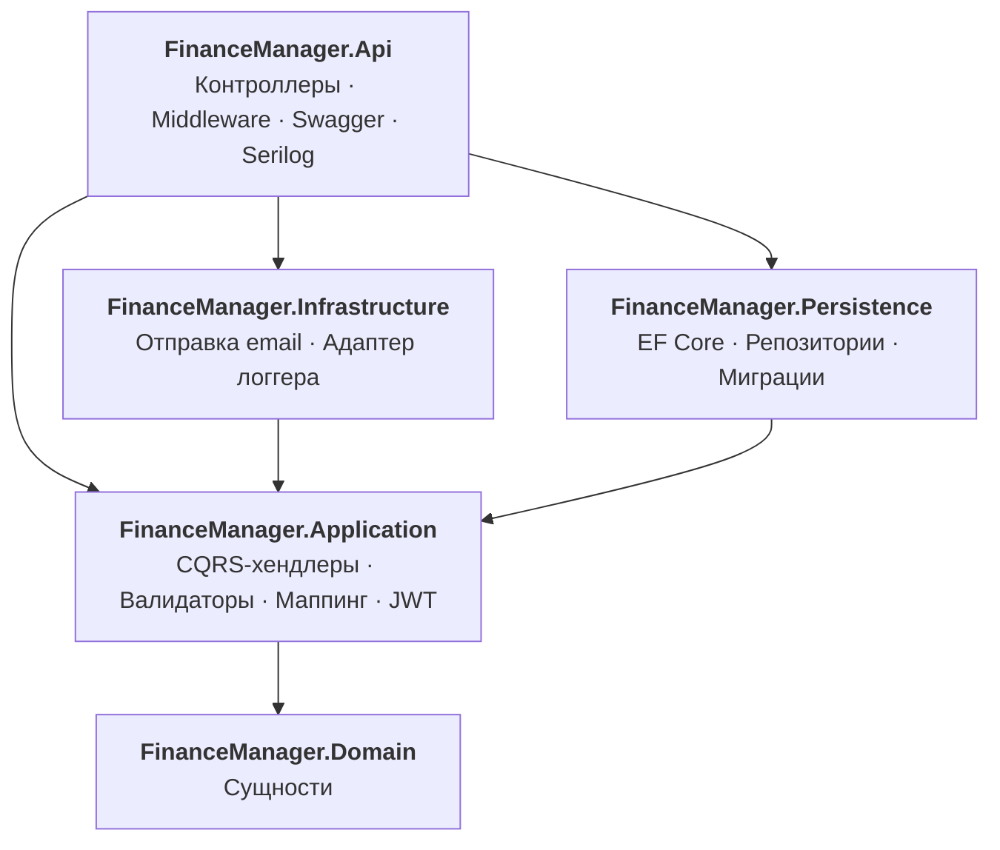
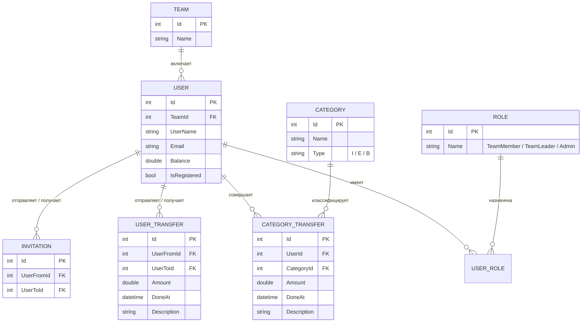

# FinanceManager

REST API для совместного учёта личных финансов: доходы и расходы по категориям, переводы между пользователями и общий бюджет команды (семьи).


---

## Содержание

- [О проекте](#о-проекте)
- [Возможности](#возможности)
- [Бизнес-правила](#бизнес-правила)
- [Технологии](#технологии)
- [Архитектура](#архитектура)
- [Модель данных](#модель-данных)
- [Безопасность](#безопасность)
- [API](#api)
- [Быстрый старт](#быстрый-старт)
- [Структура репозитория](#структура-репозитория)

## О проекте

**FinanceManager** — бэкенд приложения для учёта финансов. Каждый пользователь ведёт свой баланс и записывает операции по категориям («Заработная плата», «Продукты», «Такси» и т. д.). Пользователи объединяются в **команды**, например семью: приглашают друг друга, смотрят операции всей команды и переводят друг другу деньги.

Проект построен по принципам **Clean Architecture** с разделением команд и запросов (**CQRS**) через MediatR. В API **32 эндпоинта**: аутентификация, профиль, команды, приглашения, категории, операции и переводы.

## Возможности

**Аккаунт и аутентификация**
- Регистрация с подтверждением по email
- Вход по JWT: access-токен и refresh-токен, который обновляется при каждом использовании
- Восстановление пароля через одноразовый токен, отправленный на почту
- Смена пароля, имени пользователя и email (новая почта подтверждается по ссылке)
- Редактирование профиля, просмотр текущего баланса

**Команды и приглашения**
- При регистрации у каждого пользователя появляется личная команда, где он лидер
- Приглашения в команду: отправить, принять, отклонить или отозвать
- Управление составом: исключить участника, передать роль лидера, выйти из команды
- Переименование команды, список участников

**Финансы**
- Справочник из 25 категорий трёх типов: доход, расход, универсальная
- Операции по категориям: баланс пересчитывается при добавлении и удалении
- Переводы между пользователями: списание у отправителя и зачисление получателю, отмена перевода откатывает оба баланса
- Выборки с фильтрами по периоду, категории, типу операции и охвату («мои» или «вся команда»), сортировка по любому полю

## Бизнес-правила

Правила проверяются в валидаторах (FluentValidation) на уровне Application, до того как данные попадут в базу:

| Правило | Где реализовано |
|---|---|
| Знак суммы соответствует типу категории: доход только `> 0`, расход только `< 0`, универсальная — любой | `CreateCategoryTransferCommandValidator` |
| Баланс не может стать отрицательным: нельзя потратить или перевести больше, чем есть, и нельзя удалить операцию, если после отката баланс уйдёт в минус | валидаторы `Create*` / `Delete*` |
| Нельзя перевести деньги самому себе | `CreateUserTransferCommandValidator` |
| Удалить операцию или перевод может только его автор | `Delete*CommandValidator` |
| Лидер не может покинуть команду, пока в ней есть другие участники | `AcceptInvitationCommandHandler` |
| Исключать участников может только лидер и только из своей команды | `KickUserCommandValidator` |
| Нельзя пригласить того, кто уже в твоей команде, и нельзя отправить одно приглашение дважды | `CreateInvitationCommandValidator` |
| Если регистрация не подтверждена и токен истёк, старая запись удаляется и регистрацию можно пройти заново | `RegisterCommandHandler` |
| При вступлении в команду удаляются все встречные приглашения между пользователем и этой командой | `AcceptInvitationCommandHandler` |

## Технологии

| Область | Инструменты |
|---|---|
| Платформа | .NET 8, C# 12, ASP.NET Core Web API |
| Данные | Entity Framework Core 8 (Code First, Fluent API, миграции, seed-данные), MS SQL Server |
| Архитектура | Clean Architecture, CQRS, MediatR 12 |
| Валидация и маппинг | FluentValidation 11, AutoMapper 12 |
| Аутентификация | JWT Bearer (`Microsoft.AspNetCore.Authentication.JwtBearer`), PBKDF2-хэширование паролей |
| Логирование | Serilog: консоль и файлы с ежедневной ротацией |
| Документация API | Swagger / OpenAPI (Swashbuckle) с поддержкой Bearer-авторизации |
| Почта | SMTP (`System.Net.Mail`) |

## Архитектура

Решение разделено на пять проектов. Зависимости направлены внутрь: бизнес-логика не знает ни о EF Core, ни о SMTP и работает только с интерфейсами из `Application/Contracts`.



| Проект | Ответственность |
|---|---|
| `Domain` | Сущности предметной области и базовый класс `BaseEntity` с полями аудита. Ни от чего не зависит |
| `Application` | Use case'ы в виде команд и запросов MediatR, валидаторы, профили AutoMapper, контракты репозиториев и сервисов, генерация токенов |
| `Persistence` | `DbContext`, конфигурации сущностей через Fluent API, Generic Repository и специализированные репозитории, миграции |
| `Infrastructure` | Реализации внешних сервисов: SMTP-рассылка, адаптер `IAppLogger<T>` над `ILogger` |
| `Api` | HTTP-слой: тонкие контроллеры, которые только передают запросы в MediatR; глобальная обработка ошибок; конфигурация Swagger, CORS, аутентификации |

### Применённые паттерны и приёмы

- **CQRS + Mediator.** Каждый use case — отдельная папка `Features/<Область>/Commands|Queries/<Название>` с командой, хендлером, валидатором и DTO ответа (вертикальные срезы).
- **Repository + Generic Repository.** Общий CRUD в `GenericRepository<T>`, сложные выборки с фильтрацией и сортировкой — в специализированных репозиториях.
- **Options pattern.** Настройки JWT и почты типизированы (`JwtSettings`, `EmailSettings`) и внедряются через `IOptions<T>`.
- **Adapter.** `IAppLogger<T>` отвязывает бизнес-логику от конкретной библиотеки логирования.
- **Модульная регистрация DI.** Каждый слой регистрирует свои зависимости в extension-методе: `AddApplicationServices`, `AddPersistenceServices`, `AddInfrastructureServices`.
- **Централизованный аудит.** `CreatedAt` и `ModifiedAt` проставляются автоматически в переопределённом `SaveChangesAsync`.
- **Глобальная обработка ошибок.** `ExceptionMiddleware` переводит доменные исключения в HTTP-ответы формата [RFC 7807 Problem Details](https://datatracker.ietf.org/doc/html/rfc7807).

## Модель данных



- Все сущности наследуют `BaseEntity` (`Id`, `CreatedAt`, `ModifiedAt`).
- Тип категории: `I` — доход, `E` — расход, `B` — универсальная (например, «Подарки»). Допустимые значения дополнительно защищены check-constraint в БД.
- Роли и 25 категорий создаются при применении миграций (seed через `HasData`).
- Уникальные индексы на `UserName`, `Email`, названия ролей и категорий, а также на пару «отправитель — получатель» приглашения.

## Безопасность

- **Пароли** хэшируются с помощью **PBKDF2-HMAC-SHA256**: 50 000 итераций, случайная соль 16 байт. Хэши сравниваются за постоянное время (`CryptographicOperations.FixedTimeEquals`), что защищает от timing-атак. Параметры алгоритма хранятся вместе с хэшем, поэтому их можно менять без миграции старых паролей.
- **JWT access-токен** подписывается HMAC-SHA256 и проверяется по issuer, audience, подписи и сроку действия с нулевым `ClockSkew`. Роли пользователя передаются в claims.
- **Refresh-токен** — криптографически стойкая случайная строка (64 байта). Хранится в БД и заменяется новым при каждом обновлении (rotation).
- **Одноразовые токены** с ограниченным сроком жизни используются для подтверждения регистрации, сброса пароля и смены email.
- **Политика паролей:** минимум 6 символов, хотя бы одна заглавная буква, одна строчная и одна цифра.
- Все эндпоинты, кроме `/api/auth/*` и подтверждения смены email, требуют авторизации (`[Authorize]`). Хендлеры берут идентификатор пользователя из claim токена, а не из тела запроса, и проверяют, что запрошенная операция или перевод принадлежит этому пользователю.

## API

Интерактивная документация доступна в Swagger UI после запуска: `https://localhost:5001/swagger`.
🔒 — требуется заголовок `Authorization: Bearer <accessToken>`.

<details>
<summary><b>Auth</b> — регистрация и вход</summary>

| Метод | Маршрут | Описание |
|---|---|---|
| `POST` | `/api/auth/register` | Регистрация. На почту отправляется ссылка подтверждения |
| `GET` | `/api/auth/confirmRegistration?token=` | Подтверждение регистрации по ссылке из письма |
| `POST` | `/api/auth/login` | Вход, возвращает access- и refresh-токены |
| `POST` | `/api/auth/refresh` | Обновление пары токенов |
| `POST` | `/api/auth/forgotPassword` | Отправка токена сброса пароля на почту |
| `POST` | `/api/auth/resetPassword` | Установка нового пароля по токену |

</details>

<details>
<summary><b>Users</b> — профиль и действия в команде</summary>

| Метод | Маршрут | Описание |
|---|---|---|
| `GET` | `/api/users/me` 🔒 | Профиль и баланс текущего пользователя |
| `PATCH` | `/api/users/me` 🔒 | Изменение имени, фамилии, пола |
| `POST` | `/api/users/me/changeUserName` 🔒 | Смена имени пользователя |
| `POST` | `/api/users/me/changePassword` 🔒 | Смена пароля |
| `POST` | `/api/users/me/changeEmail` 🔒 | Запрос смены email. Ссылка подтверждения уходит на новый адрес |
| `GET` | `/api/users/me/changeEmailConfirm?token=` | Подтверждение смены email |
| `POST` | `/api/users/me/leave` 🔒 | Выход из команды (пользователь получает новую личную команду) |
| `POST` | `/api/users/{id}/giveLeader` 🔒 | Передача роли лидера участнику команды |
| `POST` | `/api/users/{id}/kick` 🔒 | Исключение участника из команды |

</details>

<details>
<summary><b>Teams</b> — команда пользователя</summary>

| Метод | Маршрут | Описание |
|---|---|---|
| `GET` | `/api/teams/my` 🔒 | Информация о своей команде |
| `PUT` | `/api/teams/my` 🔒 | Переименование команды |
| `GET` | `/api/teams/my/users` 🔒 | Участники команды |

</details>

<details>
<summary><b>Invitations</b> — приглашения в команду</summary>

| Метод | Маршрут | Описание |
|---|---|---|
| `GET` | `/api/invitations?type=fromMe\|toMe` 🔒 | Исходящие и (или) входящие приглашения |
| `POST` | `/api/invitations` 🔒 | Пригласить пользователя в свою команду |
| `POST` | `/api/invitations/{id}/accept` 🔒 | Принять приглашение и перейти в команду |
| `POST` | `/api/invitations/{id}/decline` 🔒 | Отклонить входящее или отозвать исходящее приглашение |

</details>

<details>
<summary><b>Categories</b> — справочник категорий</summary>

| Метод | Маршрут | Описание |
|---|---|---|
| `GET` | `/api/categories?type=income\|expenses` 🔒 | Список категорий (универсальные попадают в оба списка) |
| `GET` | `/api/categories/{id}` 🔒 | Категория по идентификатору |

</details>

<details>
<summary><b>CategoryTransfers</b> — доходы и расходы</summary>

| Метод | Маршрут | Описание |
|---|---|---|
| `GET` | `/api/categoryTransfers` 🔒 | Список операций с фильтрами и сортировкой |
| `GET` | `/api/categoryTransfers/{id}` 🔒 | Операция по идентификатору |
| `POST` | `/api/categoryTransfers` 🔒 | Добавить доход или расход, баланс пересчитывается |
| `DELETE` | `/api/categoryTransfers/{id}` 🔒 | Удалить свою операцию, баланс откатывается |

Параметры `GET /api/categoryTransfers`:

| Параметр | Значения |
|---|---|
| `from` | `me` (по умолчанию) или `myTeam` |
| `type` | `income` или `expenses` (по умолчанию — оба типа) |
| `categoryId` | идентификатор категории |
| `startDate`, `endDate` | границы периода |
| `sortColumn` | `id`, `userId`, `categoryId`, `amount`, `doneAt`, `description` |
| `sortOrder` | `asc` (по умолчанию) или `desc` |

</details>

<details>
<summary><b>UserTransfers</b> — переводы между пользователями</summary>

| Метод | Маршрут | Описание |
|---|---|---|
| `GET` | `/api/userTransfers` 🔒 | Список переводов с фильтрами и сортировкой |
| `GET` | `/api/userTransfers/{id}` 🔒 | Перевод по идентификатору |
| `POST` | `/api/userTransfers` 🔒 | Перевести деньги другому пользователю |
| `DELETE` | `/api/userTransfers/{id}` 🔒 | Отменить свой перевод, оба баланса откатываются |

Параметры `GET /api/userTransfers`: `from` и `to` (`me` или `myTeam`; если не указан ни один, используется `from=me`), `startDate`, `endDate`, `sortColumn` (`id`, `userFromId`, `userToId`, `amount`, `doneAt`, `description`), `sortOrder`.

</details>

### Примеры запросов

Вход:

```http
POST /api/auth/login
Content-Type: application/json

{
  "email": "ivan@example.com",
  "password": "Secret123"
}
```

```json
{
  "userId": 1,
  "userName": "ivan",
  "email": "ivan@example.com",
  "accessToken": "eyJhbGciOiJIUzI1NiIsInR5cCI6IkpXVCJ9...",
  "refreshToken": "q8JpZ3...=="
}
```

Добавление расхода (категория 4 — «Продуктовый магазин»):

```http
POST /api/categoryTransfers
Authorization: Bearer <accessToken>
Content-Type: application/json

{
  "categoryId": 4,
  "amount": -1250.50,
  "doneAt": "2024-02-10T18:30:00Z",
  "description": "Продукты на неделю"
}
```

### Формат ошибок

Все ошибки возвращаются в едином формате Problem Details. Ошибки валидации сгруппированы по полям:

```json
{
  "type": "BadRequestException",
  "title": "Invalid CreateCategoryTransferCommand",
  "status": 400,
  "errors": {
    "Amount": [ "Amount must be less than 100000" ],
    "DoneAt": [ "Done At must be less than Now" ]
  }
}
```

| Исключение | HTTP-статус |
|---|---|
| `BadRequestException` (в том числе ошибки валидации) | `400 Bad Request` |
| `NotFoundException` | `404 Not Found` |
| Любое другое | `500 Internal Server Error` |

## Быстрый старт

### Требования

- [.NET 8 SDK](https://dotnet.microsoft.com/download/dotnet/8.0)
- MS SQL Server: LocalDB (устанавливается вместе с Visual Studio), Express или Developer
- Инструмент EF Core CLI: `dotnet tool install --global dotnet-ef`

### Установка

1. Клонируйте репозиторий:

   ```bash
   git clone https://github.com/KonstantinUsikov/FinanceManager.git
   cd FinanceManager
   ```

2. Задайте настройки. Все параметры находятся в `FinanceManager.Api/appsettings.json`: секции `ConnectionStrings`, `EmailSettings` и `JwtSettings`. По умолчанию используется LocalDB, поэтому строку подключения нужно менять, только если у вас другой экземпляр SQL Server. Секреты удобнее хранить вне репозитория, в [user-secrets](https://learn.microsoft.com/aspnet/core/security/app-secrets):

   ```bash
   cd FinanceManager.Api
   dotnet user-secrets init
   # необязательно: если используется не LocalDB
   dotnet user-secrets set "ConnectionStrings:FinanceManagerDatabaseConnectionString" "Server=localhost;Database=FinanceManagerDB;Trusted_Connection=True;TrustServerCertificate=True"
   dotnet user-secrets set "EmailSettings:FromMail" "your-mail@gmail.com"
   dotnet user-secrets set "EmailSettings:FromPassword" "<пароль приложения>"
   dotnet user-secrets set "JwtSettings:Key" "<случайная строка длиной не меньше 32 символов>"
   cd ..
   ```

   > Ключ JWT должен быть не короче 256 бит (32 символа), иначе HMAC-SHA256 не сможет подписать токен.

3. Создайте базу данных. Миграции создадут схему, роли и справочник категорий:

   ```bash
   dotnet ef database update --project FinanceManager.Persistence --startup-project FinanceManager.Api
   ```

4. Запустите API:

   ```bash
   dotnet dev-certs https --trust
   dotnet run --project FinanceManager.Api --launch-profile https
   ```

5. Откройте Swagger UI: **https://localhost:5001/swagger**. Логи пишутся в консоль и в файлы `logs/log-<дата>.txt`.

### Проверка за пару минут

1. `POST /api/auth/register` — зарегистрируйтесь с реальным email.
2. Откройте ссылку из письма, чтобы подтвердить регистрацию.
3. `POST /api/auth/login` — скопируйте `accessToken` из ответа.
4. Нажмите **Authorize** в Swagger UI и вставьте токен.
5. `POST /api/categoryTransfers` с `categoryId: 1` («Заработная плата») и положительной суммой.
6. `GET /api/users/me` — баланс увеличился на сумму операции.

## Структура репозитория

```text
FinanceManager/
├── FinanceManager.Api/                 # HTTP-слой и точка входа
│   ├── Controllers/                    # Тонкие контроллеры: запрос → MediatR → ответ
│   ├── Middleware/ExceptionMiddleware.cs
│   ├── Models/CustomProblemDetails.cs
│   └── Program.cs                      # DI, Swagger, Serilog, аутентификация
├── FinanceManager.Application/         # Бизнес-логика
│   ├── Contracts/                      # Интерфейсы репозиториев, email, логгера, токенов
│   ├── Exceptions/                     # BadRequestException, NotFoundException
│   ├── Features/                       # Use case'ы в виде вертикальных срезов
│   │   └── CategoryTransfers/
│   │       ├── Commands/
│   │       │   └── CreateCategoryTransfer/
│   │       │       ├── CreateCategoryTransferCommand.cs
│   │       │       ├── CreateCategoryTransferCommandHandler.cs
│   │       │       └── CreateCategoryTransferCommandValidator.cs
│   │       └── Queries/
│   │           └── GetCategoryTransfers/
│   ├── MappingProfiles/                # Профили AutoMapper
│   ├── Models/                         # JwtSettings, EmailSettings
│   └── Services/                       # TokenService, UserService
├── FinanceManager.Domain/              # Сущности без внешних зависимостей
├── FinanceManager.Infrastructure/      # SMTP-рассылка, адаптер логгера
└── FinanceManager.Persistence/         # DbContext, Fluent API, репозитории, миграции
```
